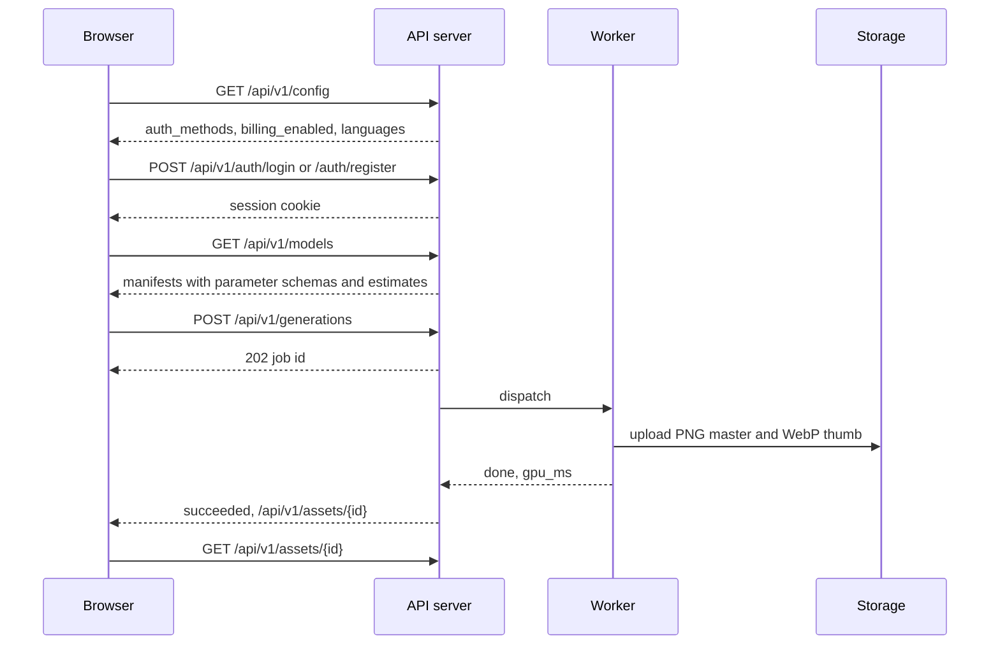
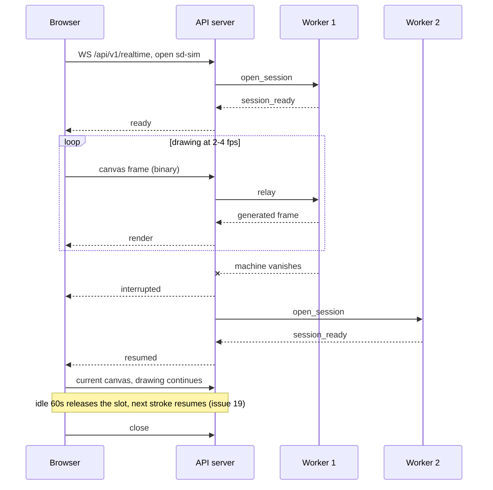
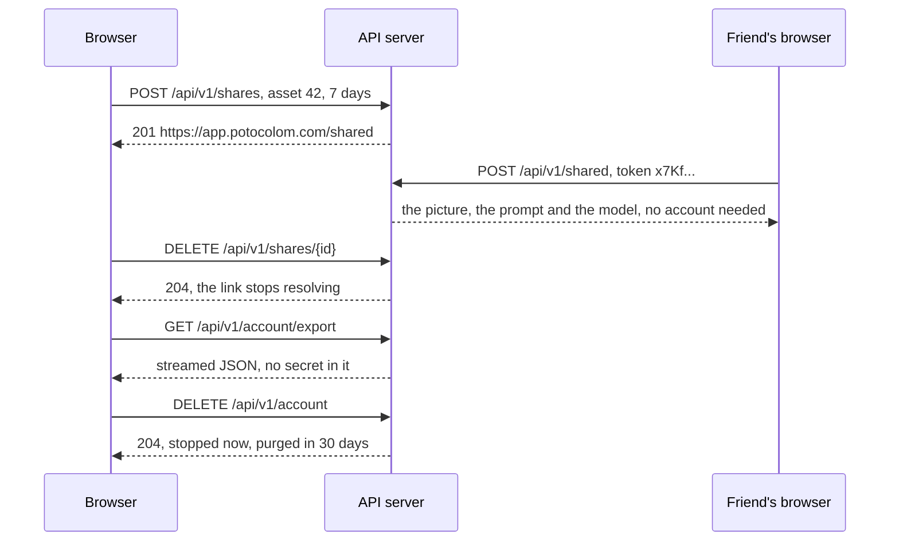

# API reference and user journeys

Every call a customer's browser makes, from first page load to account deletion. Endpoints that exist today are marked implemented; everything else names the issue that ships it, so this document doubles as the API-level view of the roadmap. The wire-level details of the two WebSocket endpoints live in [connection-handling.md](connection-handling.md); this document covers what flows over them and over REST.

<!-- Status markers corrected 2026-07-23: models + generations + history + progress + studio/metrics/benchmark/files endpoints are implemented (were marked planned). -->

## Conventions

- Base path `/api/v1`. JSON request and response bodies.
- Authentication resolves requests to a principal. In none mode, the principal is one implicit local admin.
- While the installation is unclaimed, every API route answers `503` with `{"detail": "setup_required"}` before it reads any data. The exceptions are `GET /api/v1/config`, `GET /api/v1/health`, `GET /api/v1/ready`, `POST /api/v1/auth/setup`, `POST /api/v1/auth/setup/status` and the fleet socket. A browser WebSocket is closed before it is accepted, so its handshake fails instead of answering `503`. The setup link decides the mode, so nothing else answers until it is spent (docs/self-hosting.md, First run).
- Authorization is the `role` column on the user, ranked `viewer` < `user` < `admin`:
  `admin` covers everything including install configuration, `user` creates and mutates
  its own work, `viewer` is read-only. Write endpoints require `user` or `admin` and
  answer 403 for a `viewer`. The code calls the `user` tier "member" in
  `require_role("member")`; the stored value is `user`.
- A request string that PostgreSQL cannot store, one holding U+0000 or a lone surrogate,
  answers 422 before any other check, in a body field, a query or a path parameter. That
  comes ahead of every answer documented below, including login's 401 and reset's 202, and
  it is the same for every account, so it says nothing about whether one exists.
- In `AUTH_MODE=accounts` a request authenticates with a session: 32 random bytes, kept only as a SHA-256 hash. Over HTTPS the cookies are `__Host-potocolom_session` and `__Host-potocolom_csrf`; over plain HTTP, which is what LAN self-hosting uses, they are `potocolom_session` and `potocolom_csrf`, because the `__Host-` prefix requires `Secure` and a browser drops a `Secure` cookie on plain HTTP. The session cookie is `HttpOnly`, `SameSite=Lax`, host-only and `Path=/`. The CSRF cookie is readable, because the browser has to echo it back.
- An unsafe request authenticated by cookie needs an exact `Origin` and an `X-CSRF-Token` header matching the CSRF cookie, or it answers 403. An absent `Origin` is refused. A request authenticated by `Authorization: Bearer` needs neither, because a bearer is presented deliberately rather than sent along by the browser. A bearer wins outright: an invalid one answers 401 and never falls back to the cookie.
- In `AUTH_MODE=none`, every `POST`, `PUT`, `PATCH` and `DELETE` needs an `Origin` that is exactly `PUBLIC_URL` or one of `ALLOWED_ORIGINS`, or it answers 403. An absent `Origin` is refused, and a safe method needs none. The studio's own browser sends its origin, so it is unaffected. A script that calls the API in none mode must send the same header: `scripts/generate.py`, `scripts/benchmark.py` and `scripts/generate-hero-batch.py` send `PUBLIC_URL` when it is set, and otherwise the origin of the API they call; `scripts/release-check.py` and `scripts/compose-smoke.sh` send the public address of the install they test. Before this rule, none accepted such a request from any page the operator visited.
- Sessions last 12 hours. Remember-me lasts 30 days with a 7-day idle window. An administrator gets 12 hours with a 30-minute idle window and cannot be remembered. Recent authentication lasts 30 minutes, is granted by signing in, and is never granted by claiming the installation.
- `disabled`, `deletion_pending` and `purging` accounts cannot sign in, and their existing sessions stop resolving. A `suspended` account signs in read-only: safe methods answer normally and anything else answers 403.
- Registration is invitation-only. An invitation is bound to one address, good once, and valid 72 hours. It may be copied and handed over by any means, because a self-hosted install is not required to have mail. Only the hash is stored, so the link is shown once at creation; revealing it again mints a fresh one and retires the previous, on the assumption that a link nobody could see may have leaked on the way.
- Promoting an account to `admin` needs recent authentication from the caller, and either a verified address on the target or an explicit `attested` flag. The attestation is recorded with the target, because on an install with no mail nothing else can say who that address belongs to. An administrator can never change their own role, and the last administrator cannot be demoted: an install with no administrator can only be recovered offline.
- A role change revokes every session the account held, since the old session carries the old authority.
- Enrolling a second factor writes nothing until it is confirmed. `POST /api/v1/account/totp` returns the secret, its `otpauth://` URI, the recovery codes, and an opaque `enrolment` value the browser hands back to `POST /api/v1/account/totp/confirm` along with a code from the authenticator. Only that confirmation writes the factor and its codes, replacing whatever the account had before in one transaction. An enrolment that is started and abandoned therefore leaves a working factor working, and the `enrolment` value is bound to the account that started it and expires in 30 minutes. The confirming code is spent like any other, so a sign-in inside the same 30 seconds needs the next one. Replacing a factor that already exists also needs `current_code`, a code from the authenticator being retired or one of its recovery codes: the code proving the new secret proves only that the caller holds the new authenticator, which whoever asked for the secret does by definition. A first enrolment has nothing to replace and is asked for nothing. Ten `current_code` attempts end replacement for that factor, counted whether or not the code was right, and answering a login challenge with it gives the budget back. So the bound is ten attempts between one successful factor challenge and the next. Confirming needs an active account, so an enrolment begun before a suspension does not land after it. Two first enrolments racing answer `409` to the one that loses, since an account holds one factor and neither of them had one to replace.
- Passwords must be 10 to 128 characters and must not appear in the bundled blocklist.
- A second factor is optional for every role. When an account has enrolled and confirmed one, a correct password or a provider sign-in returns `200 {"totp_required": true}` and a short-lived challenge cookie instead of a session. `POST /api/v1/auth/totp` answers it with a TOTP code or a one-use recovery code and returns the session. The challenge lives ten minutes, allows ten attempts, and carries no authority of its own: an administrator part way through it can reach nothing. TOTP gates sign-in and nothing else; it does not gate setup, invitation acceptance, promotion or recovery, and it changes neither what an account may do nor how long its session lasts.
- `POST /api/v1/auth/reset` always answers `202` with the same body, whether or not anybody holds that address. A non-administrator is emailed a one-use link valid 30 minutes. An administrator is emailed nothing, ever: their way back is `make auth-recover`, run at the machine, which prints a one-use link valid 10 minutes. Completing either sets the password, revokes every session that account held, and returns the person to the login screen with no session and no recent-authentication grant.
- Changing how an account is proved needs recent authentication, and changing a password that already exists needs the current one as well: recent authentication says this browser was somebody's, and the current password says it is still theirs at this keyboard. Every such change ends the account's other sessions and leaves the browser making it signed in, because the usual reason to change a credential is that somebody else holds the old one. It also rotates the token of the session making it: the response carries fresh `Set-Cookie` headers for both the session and the CSRF cookie, and the token presented with the request stops working. A copy of that cookie is what a stolen session is, so without this the one session the change most needs to end was the one it left alone. A client that loses the response is signed out and has to sign in again. Two changes presenting the same session token both reach that swap, since the principal is resolved before either of them writes; the one whose token is no longer the stored one answers `409`, writes nothing and sets no cookie. Saving the address the account already holds is not one of these changes and does none of it (see below).
- Changing the primary address resets `mail_verified` and moves the password identity with it. A provider proved the old address and says nothing about the new one, and login matches on the identity, so leaving it behind would sign somebody in under an address they no longer hold. An address another account holds answers 409. Saving the address the account already holds is not a change, in any case of the letters: it answers `204`, writes nothing, ends no session and rotates nothing, so `mail_verified` stays as it was.
- Unlinking a provider refuses when it is the only credential left, because an account with no way in can only be recovered offline.
- A route requiring `admin` with an unsafe method is audited before it runs, with the actor, the role, and the route template as the action name. A read that reaches another user's data records its own target, because the role check sees the caller and the route and never which account the answer came from. The studio's own admin polls are not audited: they carry no target and recording them would bury real administrator work under millions of rows any caller can drive for free. The record is durable in PostgreSQL and kept 90 days. Audit fails open: an action still proceeds when only its record fails, and the gap becomes visible instead of silent (see [SECURITY.md](../SECURITY.md)). The audit is read through `GET /api/v1/audit` and the routes beside it.
- REST errors use FastAPI's shape: `{"detail": "..."}` with a conventional status code.
- A request body larger than the path cap answers `413 {"detail": "request body too large"}`. JSON and form requests are refused before the route runs. JSON and form requests cap at 1 MiB, file uploads at 64 MiB, and SES feedback at 512 KiB.
- Responses under `/api/v1/` include `Cache-Control: no-store`.
- Every HTTP response carries an `X-Request-ID` header: 32 hex characters generated by the server, on success and on every error alike. An `X-Request-ID` sent by a client is ignored; only a value the server generated is safe to log. The same id is stamped onto every application log record produced while that request is handled, so an operator can tie a response a person is holding to the server's log lines, where it appears as `request_id` in JSON logs and as ` request_id=<id>` at the end of a plain log line. WebSocket connections have no request id.
- WebSocket errors are control messages `{"type": "error", "code": <int>, "message": "..."}` followed by a close with the same code; the code table is in [connection-handling.md](connection-handling.md).
- API versioning is the path prefix. The worker protocol versions independently with an N-1 compatibility promise, and the API tolerates the previous release's SPA through additive-only response changes over the same release window.

## Endpoint catalogue

| Method and path | Status | Purpose |
|---|---|---|
| GET, HEAD `/api/v1/health` | implemented | process liveness for the load balancer; HEAD answers the same with no body, for probes |
| GET `/api/v1/ready` | implemented | PostgreSQL and asset-storage readiness |
| GET `/api/v1/config` | implemented | runtime configuration for the SPA; `setup_required` tells it to show setup |
| WS `/api/v1/realtime` | implemented | realtime drawing sessions; studio client on `/app`; in accounts mode the session cookie authenticates the upgrade, and revoking that session closes the socket |
| WS `/api/v1/fleet` | implemented | worker fleet connection, not for browsers: a handshake carrying a non-allowlisted `Origin` is refused, as is one whose `X-Fleet-Token` is neither the shared secret nor a live member credential; an unset key refuses API startup; see "Fleet members" for the member rules |
| GET `/api/v1/models` | implemented | registered models with parameter schemas and GPU-time estimates; requires a principal |
| POST `/api/v1/generations` | implemented (#11, #16) | queue a generation job (text2img, img2img, or upscale) |
| GET `/api/v1/generations/{id}` | implemented (#16) | job state, result asset when done |
| GET `/api/v1/generations` | implemented (#16) | generation history: jobs with nested opaque asset-ID URLs, cursor paging |
| GET `/api/v1/generations/models` | implemented | model IDs and names used by the current user's saved images, including historical models |
| GET `/api/v1/generations/{id}/events` | implemented (#16) | server-sent-events stream of job progress (polling the job endpoint is the fallback) |
| POST, DELETE `/api/v1/generations/{id}/star` | implemented (#124) | idempotently star or unstar an owned generation |
| GET `/api/v1/generations/{id}/lineage` | implemented (#129) | ancestry, direct derivatives and subtree size of an owned generation |
| GET `/api/v1/generations/{id}/subtree` | implemented (#130) | bounded descendants and render data for one Images canvas tree |
| GET `/api/v1/benchmark/sessions/*` | implemented | list and read durable benchmark sessions; admin only |
| POST `/api/v1/benchmark/sessions` | implemented, `BENCHMARK_API`-gated | ingest a completed benchmark session; admin only |
| GET `/api/v1/studio/gpu` | implemented | live GPU snapshot (util, VRAM, temperature, power) and loaded models for the studio metrics panel; admin only |
| GET `/api/v1/metrics/gpu/history` | implemented | GPU telemetry over a time range (raw, or 5-minute rollups); admin only |
| GET `/api/v1/usage/me` | implemented (#95) | the caller's own usage events over a time range: totals, category mix, per model and category x model; member and admin, 403 for viewer |
| GET `/api/v1/benchmark/models` | implemented, `BENCHMARK_API`-gated | list benchmarkable models; admin only |
| GET `/api/v1/benchmark/gpu` | implemented, `BENCHMARK_API`-gated | live GPU status from a connected worker; admin only |
| POST `/api/v1/benchmark/gpu/load` | implemented, `BENCHMARK_API`-gated | load a model for a benchmark run; admin only |
| POST `/api/v1/benchmark/gpu/unload` | implemented, `BENCHMARK_API`-gated | unload a model after a benchmark run; admin only |
| PUT `/api/v1/files/{key}` | implemented | local-storage upload target; capability-bound worker writes |
| GET `/api/v1/files/{key}` | retired | answers `404`. Key-addressed asset reads were removed in R1; assets are read by id. The route is still declared, because the `PUT` above matches the same path and removing it would answer `405` instead |
| GET `/api/v1/assets/{id}` | implemented | owner- or admin-checked asset bytes; missing and unauthorized assets return 404; an administrator's read of another account's bytes is recorded |
| GET `/api/v1/shared-picture` | implemented | short-lived picture bytes for a resolved share; no account needed |
| GET `/api/v1/worker-input` | implemented | local-storage worker fetch of a source image; opaque 15-minute capability |
| POST `/api/v1/auth/register` | implemented | accept an invitation and set a password; returns a clean session |
| GET `/api/v1/auth/verify` | not implemented | no mail-verification link target; invitation accept is `POST /api/v1/auth/register` |
| POST `/api/v1/auth/setup` | implemented | spend the one-use setup link and choose accounts (returns a session) or none (no session) |
| POST `/api/v1/auth/enable` | implemented | none mode only: an administrator turns accounts on with an email and password, with no restart; returns a session, and closes every canvas opened without one |
| POST `/api/v1/auth/login` | implemented | password sign-in; sets the session and CSRF cookies; rate limited per identifier, and delayed but never refused per address |
| POST `/api/v1/auth/logout` | implemented | revoke the session this request used |
| GET `/api/v1/auth/redirect/{provider}` | implemented | start a provider sign-in; 404 unless that provider is listed and has credentials; accepts an optional `next`, a same-origin `/app` address whose query a successful callback returns to (a factor challenge carries it to `/login`), and anything else is ignored |
| GET `/api/v1/auth/callback/{provider}` | implemented | finish a provider sign-in or a link; never creates an account; a link ends the account's other sessions, re-issues this one's cookies and returns to `/app?view=account` |
| POST `/api/v1/invitations` | implemented | invite an address to a role; returns `{id, email, role, token, link, expires_at}`, `link` being `_invitation_link(token)`, admin only |
| GET `/api/v1/invitations` | implemented | the open invitations, without their links; admin only |
| DELETE `/api/v1/invitations/{id}` | implemented | revoke an open invitation (404 once it is revoked or accepted); records `invitation.revoked` with the invitation id, address and role; admin only |
| POST `/api/v1/invitations/{id}/reveal` | implemented | re-mint the link and retire the previous one; returns the same shape as create, `link` included; records `invitation.revealed` with the invitation id, address and role, high severity for an administrator invitation; admin only |
| POST `/api/v1/users/{id}/role` | implemented | change an account's role; admin only |
| POST `/api/v1/admin/fleet/members` | implemented (#885) | create a GPU member for another machine; returns `{id, label, device, join_token, expires_at}` once, with a one-hour join token; admin only; accounts mode also needs recent authentication |
| GET `/api/v1/admin/fleet/members` | implemented (#885) | the fleet members and each one's state (`waiting`, `expired`, `connected`, `offline`, `revoked`); never a token or a credential; admin only |
| DELETE `/api/v1/admin/fleet/members/{id}` | implemented (#885) | revoke a member; the row stays; `404` for an unknown id; admin only |
| PATCH `/api/v1/admin/fleet/members/{id}` | implemented (#889) | pause or resume a member with `{"paused": true}` or `{"paused": false}`; a paused member keeps its current work and gets no new job or session; `404` for an unknown id, `409` for a revoked member; admin only |
| POST `/api/v1/fleet/enroll` | implemented (#885) | spend a join token once for a worker id and a credential; no session; every refused token gets the same `403` |
| POST `/api/v1/users/{id}/state` | implemented | suspend, disable, or mark an account for deletion; admin only |
| POST `/api/v1/generations/{id}/cancel` | implemented | stop a queued or running job |
| POST `/api/v1/auth/totp` | implemented | answer a sign-in challenge with a TOTP code or a recovery code |
| POST `/api/v1/auth/reset` | implemented | ask for a password reset link; always answers the same |
| POST `/api/v1/auth/reset/complete` | implemented | spend a reset or recovery link and set a password; returns to login |
| POST `/api/v1/account/totp` | implemented | begin enrolling a second factor; needs recent authentication |
| POST `/api/v1/account/totp/confirm` | implemented | prove the authenticator holds the secret, which is what enrols it |
| DELETE `/api/v1/account/totp` | implemented | remove the second factor; needs recent authentication and a current code or a recovery code, spends the same attempt budget as replacing one when it is an authenticator code, and ends the account's other sessions |
| POST `/api/v1/account/identities/{provider}` | implemented | start linking a provider to this account; needs recent authentication |
| DELETE `/api/v1/account/identities/{provider}` | implemented | unlink a provider; refuses the last way in |
| POST `/api/v1/account/password` | implemented | change or add a password; needs recent authentication |
| POST `/api/v1/account/email` | implemented | change the primary address; resets mail assurance; saving the address the account already holds, only spelled differently, changes nothing and keeps the assurance it has |
| GET `/api/v1/account` | implemented | this account, its live sessions, `totp` (true only when a second factor is confirmed) and `identities` (the account's providers, sorted) |
| DELETE `/api/v1/account/sessions/{id}` | implemented | revoke one of this account's own sessions |
| GET `/api/v1/account/export` | implemented | everything this install holds about the account, as streamed JSON |
| DELETE `/api/v1/account` | implemented | stop the account now; the rows and objects go in 30 days |
| POST `/api/v1/users/{id}/restore` | implemented | put an account waiting to be deleted back where it was; admin only |
| GET `/api/v1/users` | implemented | who is on this install and what state they are in; admin only |
| GET `/api/v1/users/{id}` | implemented | one account, read only, and the read is recorded; admin only |
| GET `/api/v1/users/{id}/generations` | implemented | that account's work, read only; admin only |
| GET `/api/v1/audit` | implemented | search the audit; admin only |
| GET `/api/v1/audit/summary` | implemented | seven days of privileged action, and the gaps in it; admin only |
| GET `/api/v1/audit/anomalies` | implemented | administrators reading unusually many accounts; admin only |
| GET `/api/v1/audit/export` | implemented | the filtered audit as JSON, and the export is audited; admin only |
| POST `/api/v1/shares` | implemented | mint the link for one asset, for 1, 7 or 30 days |
| DELETE `/api/v1/shares/{id}` | implemented | revoke a share; the link stops resolving |
| POST `/api/v1/shared` | implemented | resolve a share token; no account needed |
| GET `/api/v1/mail/status` | implemented | what the mail outbox is doing; admin only |
| POST `/api/v1/mail/feedback` | implemented | SES bounce and complaint notifications from SNS; `404` unless `EMAIL_BACKEND=ses`, `403` unless SNS signed it and the topic matches `SES_FEEDBACK_TOPIC_ARN`. No account credential: the signature and the topic are the credential |
| GET `/api/v1/telemetry/preview` | implemented (#29) | the exact telemetry payload that would be sent, see [metrics.md](metrics.md) |

## Implemented endpoints

### GET and HEAD /api/v1/health

Answers from process state only, so a database incident cannot convince the load balancer to kill healthy tasks.

```json
{"status": "ok"}
```

### GET /api/v1/ready

Checks PostgreSQL and the configured asset store. It returns `200` when both
are available and `503` otherwise. Use `/api/v1/health` for process liveness;
this endpoint reports whether required data services are ready.

### GET /api/v1/config

The SPA's first call. One build artifact serves every deployment; this response tells it what to show.

```json
{
  "auth_methods": [],
  "setup_required": false,
  "billing_enabled": false,
  "languages": ["en", "es"],
  "banner": null
}
```

`setup_required` is `true` while the installation is unclaimed: no choice has been made, every other API route answers `503 setup_required`, and the studio shows the setup page. `auth_methods` is empty in none mode and while unclaimed; the implicit local admin is used for requests. In accounts mode it lists `password` and each provider that has credentials. The studio login and join routes read this field to decide which sign-in controls to render.

`banner` is `null` when no banner is set, otherwise `{"kind": "high_demand" | "degraded" | "maintenance", "message_key": "..." | null, "custom_text": "..." | null}`. The SPA shows `custom_text` when it is set, otherwise the text behind `message_key` (an i18n key, `app.banner.<kind>` by default). See [Administration](#administration) for how it is set.

### WS /api/v1/realtime

The drawing tool's connection. Text messages are JSON control, binary messages are image frames (21 byte header: kind, session id, input revision, then payload; `frame_header: 1` in `open` selects the same frame without the 4 revision bytes); framing, timeouts and close codes are specified in [connection-handling.md](connection-handling.md).

Both WebSocket endpoints refuse a handshake carrying an `Origin` that is not `PUBLIC_URL` or one of `ALLOWED_ORIGINS`; the connection fails as HTTP 403 before any close code applies (see [connection-handling.md](connection-handling.md)).

Browser to API: send `{"type": "open", "model_id": "sd-sim", "params": {"prompt": "a red house"}, "frame_header": 2}` first. `frame_header` is optional and defaults to 1; 2 asks for the header that carries the input revision, and any other value is rejected with `error` 4000. Then send binary canvas frames that carry the session id and, on header 2, an input revision that starts at 1 and only ever rises for the session. A frame whose revision the API has already accepted is dropped silently: no error, no close, and nothing reaches the worker. Send `{"type": "update_params", "params": {"prompt": "a blue house"}}` to change a subset of the session parameters. The adapter models accept a `mask` selection (normalized polygons, an optional edit `prompt`, or null) in those params, and while it is set and the other params are unchanged, a delivered frame is the new render inside that selection and the previous frame outside it, with that frame's inside denoised against the frozen outside (see [decisions.md](decisions.md), "A selection freezes the realtime frame outside it; masks are normalized polygons in params"). The studio client ends the session with WebSocket close 1000. `{"type": "close"}` is still accepted. Disconnect is treated as end.

API to browser: `{"type": "ready", "session_id": "..."}`, generated frames as binary (on header 2 they carry the revision of the canvas they were rendered from, which is how an output is matched to the input that produced it; from a protocol 4 worker the API stamps the revision it last forwarded instead), and during recovery `{"type": "interrupted"}` then `{"type": "resumed"}` (re-send the current canvas). An accepted parameter update is confirmed with `{"type": "params_updated", "params": {...}}` carrying the merged parameters the API holds for the session (the browser's keys over the session's, the seed riding along) - what later frames are rendered with once a worker has them, though the worker may fill in the manifest's declared defaults for keys nobody has set, and the acknowledgement arrives even when no worker holds the session at that moment (a reassignment in flight). The browser re-sends the current canvas when this confirmation arrives, so a prompt or slider change takes effect without a new stroke. Terminal failures arrive as `error` messages before the close. A rejected `update_params` (invalid params, a `seed` change - a session's seed is fixed at open) also arrives as an `error` but leaves the session running. `update_session` carries `control_generation` from protocol 4, so a stale update cannot land on a newer attempt; the compatibility floor is 4, so every worker the API talks to reads it fenced. When no worker has room, or every candidate refused or missed the ready timeout, the session waits in the admission queue: the browser gets `{"type": "queued", "position": N}` (1-based) whenever its position changes and again on every 30 s session sweep, then `ready` once admitted. A session that was already live and is queued after losing its worker or after an idle release gets `resumed` instead, and re-sends the current canvas. Admission is first-fit in arrival order; there is no queue timeout, and closing the socket leaves the queue. 4003 now means only the per-account cap ("too many realtime sessions for this account"). Issue #19 still adds `credits_tick` and an out of credits close (an `error` message then the close) when a session's chunked reservation cannot be extended.

### GET /api/v1/models

Registered models, each with its JSON-Schema `parameters` and its measured GPU-time estimate.

```json
[
  {
    "id": "sdxl-base",
    "name": "SDXL (default)",
    "capabilities": ["text_to_image", "image_to_image"],
    "min_vram_gb": 10,
    "prompt_token_limit": 77,
    "license_id": "",
    "license_url": "",
    "commercial_max_revenue_usd": null,
    "license_registration_url": "",
    "requires_attribution": "",
    "default": true,
    "benchmark_only": false,
    "studio_capabilities": null,
    "realtime_p95_ms": null,
    "estimated_gpu_ms_default": 4200,
    "parameters": {
      "type": "object",
      "properties": {
        "prompt": {"type": "string"},
        "strength": {"type": "number", "minimum": 0, "maximum": 1, "default": 0.7}
      },
      "required": ["prompt"]
    }
  }
]
```

`parameters` is JSON Schema; the frontend renders generic controls from it, which is what makes a newly dropped model usable without a frontend release. `capabilities` is the routing key (a job is matched to a model that has the requested capability). Upscale models additionally carry an `estimated_gpu_ms_by_factor` map (per scale factor). `benchmark_only` models are hidden from normal selection and exist for the benchmark harness. `prompt_token_limit` is the text encoder window the studio warns against (issue #148); 0 or absent means the model declared no window and no warning is shown. `studio_capabilities` is the subset of `capabilities` the studio offers; null when every capability is offered. On this endpoint it is informational only: the narrowing has already been applied to `capabilities`, so the two are identical whenever it is non-null, and a client should not filter on it again. `realtime_p95_ms` is the measured single-frame p95 for the model on this fleet, which the realtime picker labels models with; null until some worker has measured it. It is the median across the workers that hold the model and have measured it, each contributing its live heartbeat measurement or, until a heartbeat carries one, the calibration it declared at hello. A worker that would serve the model but has measured nothing contributes nothing, and the worker that serves a given session is not necessarily one that contributed.

The five licence fields say what may be done with the model's weights. `license_id` is the licence's name (`apache-2.0`, `stability-ai-community`, `openrail++`); `license_url` points at the licence text. `commercial_max_revenue_usd` is the annual revenue at which commercial use needs a separate enterprise licence; null or absent means the licence sets no cap. `license_registration_url` is where a commercial user registers when the licence requires it. `requires_attribution` is the attribution string the studio renders beneath the model picker, empty when the licence demands none. All five are informational today and cross the wire for future cloud-side gating (decisions.md).

### Generations and history

`POST` queues a job; the job endpoint and the SSE stream report progress; the list endpoint is the history.

```
POST /api/v1/generations     user or admin; viewer receives 403
                             {"model_id": "sdxl-base", "params": {"prompt": "a castle at sunset"}}
                             model_id is optional: omit it and the API routes to the cheapest
                             model whose "tier" (draft|standard|premium, default standard) and
                             "capability" (text_to_image|image_to_image|upscale) fit the request;
                             without a source image the capability defaults to text_to_image,
                             with one it is required, a capability that contradicts the input
                             (text_to_image with a source image, image_to_image or upscale
                             without one) is 422, and a pinned model_id ignores both.
                             For image_to_image or upscale, also pass
                             "source_asset_id"; upscale requires a source and is mutually
                             exclusive with the diffusion capabilities. A thumbnail cannot be
                             used as source_asset_id and returns 422.
                             202 {"job_id": "..."}
                             422 when params fail the model's schema.
                             422 "params: model parameter schema is invalid" when the
                             model's own parameter schema cannot be compiled or
                             evaluated, so nothing can be checked against it.
                             Cloud rate limit, prompt screen, quota reserve and 402
                             are designed and not on this handler.

GET /api/v1/generations/{id} {"state": "queued|running|succeeded|failed|cancelled",
                              "asset": {...} when succeeded, "thumbnail_url": "...",
                              "source_asset_id": "..." (img2img/upscale),
                              "has_derivatives": true when any job uses one of its assets,
                              phase timings "input_fetch_ms"/"load_ms"/"postprocess_ms",
                              "dispatched_at"/"finished_at", "failure_reason" on failure}

GET /api/v1/generations      generation history: a list of jobs, each with its nested assets
                              carrying opaque asset-ID URLs and "thumbnail_url", plus
                              "has_derivatives" for stable client layout; cursor paging.
                              Detail and list responses always carry "expired": true when the job has master
                              assets and all of them expired, else false.
                             ?limit defaults to 50 and is capped at 200 (5000 with
                             ?fields=ids); a limit below 1 answers 422.
                             ?state=queued|running|succeeded|failed|cancelled keeps only jobs
                             in that state.
                             ?starred=true uses starred_at newest-first; false excludes favorites.
                             ?roots_only=true returns source_asset_id IS NULL; false returns only
                             derivatives. Omit it for the existing unfiltered history. Cursors must
                             come from the same filtered result and retain created_at/id ordering.
                             ?q= filters by prompt (pg_trgm, case-insensitive substring). Empty or
                             whitespace q is unfiltered. ?fields=ids returns {"ids": [...]} with the
                             same WHERE, cap 5000, so the canvas can overlay matches without
                             relayout. Cursors must also match q.
                             Repeat ?model_id= to select one or more models. The model values
                             combine with OR. Other filters combine with AND.
                             ?created_from= is inclusive; ?created_before= is exclusive.
                             Both accept ISO 8601 timestamps with a timezone. A timestamp
                             without a timezone, or from >= before, answers 422.
                             ?action=generate|image_to_image|upscale selects the image action.
                             Generate has no source asset. Upscale has a source asset and
                             a model with the upscale capability. Image-to-image has a
                             source asset and a model without that capability.
                             With roots_only=true, model, date and size filters keep a root if
                             the root or any descendant matches. Subtree responses keep
                             related images for context. When state is supplied, the
                             matching descendant must also have that state. Every ancestor
                             hop stays within the same owner's jobs and assets. Cursors
                             must match all active filters.
                             Repeat ?size=512|768|1k|2k|4k|above_4k|unknown to filter by
                             common longest-side size class. Selected sizes combine with
                             OR, then AND with every other filter. Unknown values are 422.
                             Owned master assets determine max(width,height); thumbnail
                             files never count. Positive dimensions classify as:
                             512: [1,640), 768: [640,896), 1k: [896,1536),
                             2k: [1536,3072), 4k: [3072,6144), above_4k: [6144,infinity).
                             Thus 1920 px is 2k and 3840 px UHD is 4k. Unknown means no
                             owned master has both positive width and height. Expired
                             stored masters retain their size. Any matching master admits
                             its job. Size constraints also apply to fields=ids, cursor
                             membership and matching-descendant root selection.
                             The Images view sends state=succeeded for its grid, roots
                             and search IDs. Failed or pending jobs cannot fill an image page.

GET /api/v1/generations/models   {"models": [{"id": "z-image-turbo", "name": "Z-Image Turbo"}, ...]}
                                  Sorted model IDs and names used by the current user's jobs
                                  with saved assets. Includes historical and benchmark-only
                                  models. Does not change the normal /api/v1/models list.

GET /api/v1/generations/{id}/events   server-sent events: progress ticks until a terminal state

POST /api/v1/generations/{id}/cancel  204; idempotent, and open to the owner whatever their
                                      role, since calling off your own work is not a mutation
                                      of anybody else's. An administrator may cancel any
                                      account's job; a call that stops one writes a
                                      high-severity audit row with the owner and job id.
                                      404 for anybody else's job.
                                      A job that already finished stays finished.

POST /api/v1/generations/{id}/star    user or admin; 204; idempotent, 403 for viewer,
                                      404 for another user's or missing job
DELETE /api/v1/generations/{id}/star  user or admin; 204; idempotent, 403 for viewer,
                                      404 for another user's or missing job

GET /api/v1/generations/{id}/lineage  the derivation chain around one generation (#129)
                                      {"ancestors": [entry], root first, direct parent last, [] for a root
                                       "children":  [entry], direct derivatives, created_at ascending
                                       "descendant_count": subtree size through depth 100,
                                       "descendants_truncated": true when deeper rows exist}
                                      entry = {"job_id": null when the source was an upload,
                                               "asset_id", "action": generate|image_to_image|upscale|upload,
                                               "model_id", "created_at", "state", "thumbnail_url",
                                               "missing": true once the bytes are gone, renders a ghost}
                                      404 for another user's or missing job. The walk is bounded at depth
                                      100 and skips already-visited assets, so a cycle cannot hang it.
                                      A missing ancestor keeps its place: the chain stays intact because
                                      purging an asset drops its bytes and keeps the row (decisions.md).

GET /api/v1/generations/{id}/subtree  one canvas tree in one database query (#130)
                                      {"nodes": [{"parent_job_id": null, "output_asset_ids": [],
                                                  "entry": entry,
                                                  "generation": generation}],
                                       "truncated": false,
                                       "remaining_count_lower_bound": 0,
                                       "max_depth": 100, "max_nodes": 600}
                                      Nodes are breadth-first and include the generation fields and first
                                      non-thumbnail master asset needed by the canvas. parent_job_id joins
                                      each child to its parent generation; output_asset_ids lets cache
                                      revalidation match derivatives of any output. The walk is user-owned, cycle safe, excludes
                                      thumbnail assets, and stops at both limits. When truncated, the lower
                                      bound counts known omitted branches, not every unseen descendant.
                                      404 for another user's or missing anchor job, or one that never had an
                                      asset row; an expired anchor answers 200 with `missing: true`.
```

Asset URLs use `/api/v1/assets/{id}`. The API checks the asset owner or admin role. A missing
or unauthorized asset returns 404. For an accessible asset, an unsafe `download` name returns 400.
An administrator's read of another account's bytes records a `user.read` event with that account
as the target, like every other admin read; the owner reading their own records nothing.

The studio opens at most four generation event streams. An `EventSource` error
before or after the initial event moves that job to the 1.5-second history
polling fallback; jobs above the stream cap share the same fallback refresh.
After a streamed terminal event, the studio reads that generation once so its
final row, timings and assets equal a history poll. A missed cross-replica event
cannot leave a spinner running forever, by one of two paths: while every working
job is streamed, each streamed row is reconciled on its own every 15 seconds;
while any job is on the fallback, the 1.5-second history refresh already covers
every row, streamed or not.

Job progress on this path is SSE (`/events`) and history polling. Realtime WebSocket
progress for queued jobs, credit refunds, and a retry button wait on billing and
issue #19. A failed job after its single automatic retry stays `failed`.

### Studio, metrics, benchmark and local files

```
GET /api/v1/studio/gpu                 admin only; {"loaded_models": [...], "gpu": {device,
                                        util_pct, vram_used_pct, vram_used_bytes,
                                        vram_total_bytes, temperature_c, power_w, available}}
                                        loaded_models lists the model ids currently resident
                                        on the connected worker's GPU; [] when it has none
                                        gpu is null and loaded_models is [] when workers are
                                        connected but none can answer GPU commands; 503 when
                                        no worker is connected, or when the worker answers
                                        without GPU metrics
GET /api/v1/metrics/gpu/history        admin only; ?from&to&rollup - GPU samples over a range; the endpoint
                                        auto-picks raw samples (48h retention) or 5-minute rollups
                                        (30d retention) for the requested window. See metrics.md.
                                        from and to must carry a timezone (an epoch millisecond
                                        integer or an ISO timestamp with an offset or Z); a naive
                                        timestamp answers 422. Raw mode caps the response at 5000
                                        samples, keeping the newest in the window, and sets
                                        `truncated: true` when the window held more; the field is
                                        always present and false otherwise.
GET /api/v1/usage/me                member and admin only, 403 for a viewer; ?from&to - the caller's
                                        own usage_events rows in [from, to), never another
                                        account's: totals {events, gpu_ms, frames}, by_category
                                        [{category, events}], by_model [{model_id, events,
                                        avg_gpu_ms, p50_duration_ms}], by_model_category
                                        [{model_id, category, events, avg_duration_ms}]. from and
                                        to take the same timestamps as the GPU history route and
                                        are optional: with neither, the window is the last 30
                                        days. to must be after from, and a window wider than 366
                                        days answers 422. A row with a null gpu_ms or duration_ms
                                        counts as an event and is left out of the averages; the
                                        median is percentile_cont(0.5). Sorted by events
                                        descending, then by name.
GET  /api/v1/benchmark/models          admin only; list benchmarkable models (BENCHMARK_API-gated)
GET  /api/v1/benchmark/gpu             admin only; live GPU status from a connected worker
POST /api/v1/benchmark/gpu/load        admin only; load a model for scripts/benchmark.py
POST /api/v1/benchmark/gpu/unload      admin only; unload that model
                                       There is no POST /api/v1/benchmark/run; the script
                                       uses ordinary generations plus these GPU controls.
POST /api/v1/benchmark/sessions       admin only; BENCHMARK_API-gated completed
                                        scripts/benchmark.py report;
                                        201 {"id": "..."}; 404 when the benchmark API is disabled;
                                        malformed reports return 422
GET  /api/v1/benchmark/sessions       admin only; 200 newest-first install-scoped session summaries;
                                        ?limit defaults to 50 and is capped at 200; a limit below 1
                                        answers 422; pass the last session id as ?cursor to read
                                        the next page
GET  /api/v1/benchmark/sessions/{id}  admin only; 200 full report in the existing results.json shape;
                                        404 for a missing session
GET  /api/v1/telemetry/preview        admin only; 403 for viewer or user; 200 exact previous
                                        UTC day's anonymous aggregate payload;
                                        503 when the database is unavailable
PUT  /api/v1/files/{key}               local-storage upload target (self-hosted, non-S3); a PUT is
                                        authorized only for a storage key the API minted in-flight
                                        AND an X-Upload-Token header matching that dispatch, which
                                        the worker echoes from upload.headers; 403 otherwise, and
                                        409 on a second write, since outputs are write-once
GET  /api/v1/files/{key}               always 404; this route is retired
GET  /api/v1/assets/{id}                owner or admin; serves local bytes, with 404 for missing or
                                        unauthorized assets and 400 for an unsafe download name;
                                        an administrator's read of another account's bytes is
                                        recorded with that account as the target
GET  /api/v1/shared-picture             no account; picture bytes for a resolved share
GET  /api/v1/worker-input               worker fetch of a local source image
```

For local storage, worker input URLs use `/api/v1/worker-input` with an opaque 32-byte capability.
The capability expires after 15 minutes. The URL does not contain the storage key.

## Planned endpoints, shapes fixed by the blueprint

Request and response shapes below are the contract [blueprint.md](blueprint.md) pseudocode implements; the issues fill in the behavior.

### Authentication (shipped, kept here for the exact shapes)

These four routes and the OAuth flow below them are implemented. There is no
`GET /api/v1/auth/verify`; invitation accept is `POST /api/v1/auth/register`.

```
POST /api/v1/auth/setup      {"token": "...", "mode": "accounts", "email": "ana@example.com", "password": "..."}
                             204 + the session cookies; the link is one use and lasts one hour
                             mode "accounts" (the default) claims the administrator account and
                             records accounts; email and password are then required
POST /api/v1/auth/setup/status {"token": "..."}
                             200 {"claimed": true | false} for a live setup link, without spending it
                             403 with the setup route's identical refusal for an unknown, spent or
                                 expired link; 503 if the database is unavailable
POST /api/v1/auth/setup      {"token": "...", "mode": "none"}
                             204, no cookies: the install is recorded as running without accounts
                             Answers on this route, for either choice:
                             400 an invalid email, or a password that fails the policy (accounts);
                                 the link is not spent, so the same link can be retried
                             403 a link that is unknown, spent or expired, with one body for all
                                 three; an accounts install answers this for every link, because
                                 its links are all spent or never existed
                             404 an install that runs without accounts (none mode)
                             409 a live link, but the install is already claimed or decided; the
                                 link is not spent. Minting refuses such a link, so this answers
                                 only a link minted before the install changed
                             422 a body that does not parse; the password is never echoed
                             503 root_keys_missing when ROOT_KEYS is empty; run scripts/ensure-env.sh or the installer to write keys,
                                 then recreate the API container to read them; the link is not spent
                             500 the root key ring is unusable; the link is not spent
                             503 the database is unavailable
POST /api/v1/auth/enable     {"email": "ana@example.com", "password": "..."}
                             204 + the session cookies, and the install is accounts from then on;
                             sockets without a session close with 4401, and a socket without one is
                             refused at its next open
                             A request authorized as the implicit administrator before the switch and
                             still running when it completes is accepted: in none mode every caller is
                             that administrator, so it gains nothing from the switch and loses nothing
                             Answers on this route, in the order the checks run:
                             503 the install is unclaimed (setup_required), or the database is
                                 unavailable, or the implicit administrator row is missing
                             404 an install that already runs with accounts
                             403 a caller without the admin role; none mode never produces this
                             422 a body that does not parse
                             403 the request carries no Origin, or one that is not allowed
                             409 AUTH_MODE=none is set in the environment (remove it from
                                 deploy/compose/.env and restart first), or the recorded mode is
                                 already accounts (for example after make auth-enable ran elsewhere),
                                 or an account already holds an identity
                             400 an invalid email, or a password that fails the policy; the install
                                 stays none
                             503 root_keys_missing when ROOT_KEYS is empty; run scripts/ensure-env.sh or the installer to write keys,
                                 then recreate the API container to read them; the install stays none
                             500 the root key ring is unusable; the install stays none
POST /api/v1/auth/register   {"token": "...", "password": "..."}
                             204 + the session cookies; the invitation carries the address
POST /api/v1/auth/login      {"email": "ana@example.com", "password": "...", "remember_me": true}
                             204 + Set-Cookie: potocolom_session (HttpOnly, SameSite=Lax,
                             Path=/, Secure and __Host- prefixed over HTTPS) and potocolom_csrf
                             401 on bad credentials, and on an address nobody holds
                             429 past 10 attempts for one identifier in 10 minutes; an address is
                             counted in the same window and never refused, because one NAT or one
                             untrusted proxy arrives here as a single address
                             from the sixth attempt against either, the answer is held back 0.5s
                             doubling to 8s, whether or not the credentials are right
POST /api/v1/auth/logout     204, session revoked and both cookies cleared; a session that already
                             ended, or a bearer nobody holds, still gets 204 and cleared cookies, so a
                             browser can always sign out and the answer says nothing about the token
```

OAuth: the browser navigates to `/api/v1/auth/redirect/google`; the callback exchanges the code and ends in the same session cookies as a password login. The redirect accepts an optional `next`, a same-origin `/app` address whose query a successful callback returns to (a factor challenge carries it to `/login`), and anything else is ignored. It **never finds or creates an account by email**. Registration is invitation-only, so a provider sign-in only succeeds for an identity somebody already linked deliberately, and a provider account that happens to know an address cannot become that person. Linking is a separate act: `POST /api/v1/account/identities/{provider}` needs a live session and authentication within the last 30 minutes.

Completing a link is a credential change and answers like one. The callback ends the account's other sessions, spends its outstanding reset and recovery links, and carries fresh `Set-Cookie` headers for the session and CSRF cookies on the redirect, so the token the browser presented stops working. It needs the session the flow started from: a browser signed out or revoked while it was away at the provider is refused `403` and the link does not land. Two requests presenting the same session token both reach the swap, and the one whose token is no longer the stored one answers `409`, links nothing and sets no cookie. The redirect a link ends on is `307` to `{public_url}/app?view=account`, the view it was started in; a sign-in callback, which may have started anywhere, keeps its own return.

The flow is authorization code with PKCE S256. The state is minted here and only its hash is stored, the verifier and nonce never leave the server, the redirect URI is exact, and the flow row is one use and expires in ten minutes. Google's `id_token` must carry a valid issuer, audience, expiry and nonce, and a verified email. GitHub's address is the primary verified entry from `/user/emails`. The provider's access token is discarded as soon as the identity is read; nothing here acts as an agent for the provider.

A provider-verified address raises this account's `mail_verified` only when it normalizes equal to the account's own primary address. A provider proving some other address says nothing about this one. (Google and GitHub; Apple is deferred.)

## Administration

An administrator reads any one account completely and mutates none of them, except to call off a job (see the cancel route above). There is no view that crosses accounts: the way in is always a named user.

```text
GET /api/v1/users                     ?limit= (default 50, max 200) &cursor= &q= (email substring, case-
                                      insensitive, max 200 chars); {"users": [...], "next_cursor": ...},
                                      role and state, no work and no credential; recorded for the page
                                      read, not the whole install; an unknown cursor answers 404
GET /api/v1/users/{id}                one account, plus how much work it holds
GET /api/v1/users/{id}/generations    that account's generations, read only
GET /api/v1/audit                     ?actor_user_id= &target_user_id= &action= &limit=
GET /api/v1/audit/summary             {"actions": {...}, "gaps": [...]} over seven days
GET /api/v1/audit/anomalies           administrators who opened unusually many accounts
GET /api/v1/audit/export              the same filters, as a JSON download
PUT /api/v1/admin/banner              {"kind", "message_key"?, "custom_text"?}; 204; admin only
DELETE /api/v1/admin/banner           204; admin only; clears the banner
```

- The status banner (issue #46) is one row: setting it replaces whatever was
  there, and GET /api/v1/config carries it to every client (see above). `kind`
  is `high_demand`, `degraded` or `maintenance`. `message_key`, if given, must
  be the one default key for that kind (`app.banner.<kind>`); `custom_text` is
  trimmed, plain one-line text capped at 280 characters, and wins over the key when both are present. A
  request with neither is refused `422`. It is set from the admin area, or
  cleared with `DELETE`; both are audited by the admin role check, under the route as the action name.
  Setting it automatically when the fleet autoscaler reports its ceiling, and
  clearing it when the fleet recovers, is designed but not shipped: the
  autoscaler this would read lives in the private cloud repository, not here
  (docs/repository-boundary.md).
- A privileged read records itself with the account it reached. The role check that guards these routes cannot know which account a read touched, so the route says so, and `GET /api/v1/audit?action=user.read` is the list of who looked at whom.
- Opening more than 20 different accounts within 30 minutes raises one high-severity `admin.anomaly` event and puts that administrator on the anomalies panel. The twentieth account is not the anomaly; the twenty-first is. Nothing is refused: one administrator working through a queue of complaints looks exactly like a stolen administrator session, and the difference is a person deciding, not a rule. The counting is in process, like the rest of the self-hosted path.
- Exporting the audit is itself a privileged action, so it is recorded with the ids of the events it took, capped at 100 ids with a truncation flag: the cap is what keeps one action from writing an unbounded row, and the flag is what stops a reader believing the short list is everything.
- There is no global gallery and no cross-user search of generations or assets. An administrator answering a complaint names the account; the user list's `q` only narrows which accounts show up, by email.

## Worker models

Admin only. These routes install, cancel and remove the model weights on a connected worker (docs/connection-handling.md, "Model store"). The worker answers asynchronously. Each accepted action returns `202 {"op_id": "<20-digit time_ns>-<8 random hex digits>"}`. IDs sort in issue order. A record with a later ID for the same model also answers every earlier operation on that model, which the worker runs in FIFO order.

```text
GET    /api/v1/admin/models                                       one entry per connected worker
POST   /api/v1/admin/workers/{worker_id}/models/{model_id}/install   202 queued; 409 needs_token
POST   /api/v1/admin/workers/{worker_id}/models/{model_id}/cancel    202
DELETE /api/v1/admin/workers/{worker_id}/models/{model_id}           202; refused in the download list, see below
```

- Each entry of `GET /api/v1/admin/models` has `worker_id`, `manageable`, `hardware`, `disk_free_bytes`, `suggested` (one model id or null for each of `realtime`, `text_to_image` and `upscale`) and `models`. A worker that predates model management has `manageable: false`, a `reason`, and no models; no command is sent to it (`409` on the routes above).
- Each model carries its catalog fields, `installed`, `download_bytes`, `needs_token`, `fits` (its `min_vram_gb` is at most the worker's VRAM), `suggested`, and `download`: the last `store_status` entry for it (`kind`, `state`, `bytes_done`, `bytes_total`, `error`, `op_id`), or null. The `kind` is `install`, `remove` or `cancel` and identifies the reported operation.
- Suggestions are computed from the catalog and the VRAM the worker reported. For each class the default model is offered when it fits, else the fitting model with the largest `min_vram_gb`. Benchmark-only and token-gated models are never offered. A class with no fitting model has no suggestion.
- A removal that the worker refuses shows in `download` as `state: "failed"` with `error: "in_use"`, not as an HTTP error, because the worker decides whether a session or job holds the model.
- The `POST` and `DELETE` routes are audited by the administrator role check, as other unsafe admin routes are. `GET /api/v1/admin/models` is a read and is not audited.

## Fleet members

An administrator connects a GPU on another machine in two steps (issue #885). The administrator creates a member and gets a join token once. The machine spends that token once at the enroll route, and the answer is a worker id and a credential that belong to that machine alone. The API stores only the SHA-256 of each secret.

```text
POST   /api/v1/admin/fleet/members          {"label", "device": "cuda" | "rocm"}   201
GET    /api/v1/admin/fleet/members                                                  list
DELETE /api/v1/admin/fleet/members/{id}                                             204
PATCH  /api/v1/admin/fleet/members/{id}     {"paused": true or false}              204
POST   /api/v1/fleet/enroll                 {"join_token", "base_url"}             200 {"worker_id", "credential"}
```

- The join token lives one hour and is refused once spent. `worker_id` is `m-` followed by the 32 hex characters of the member id.
- Each list entry has `id`, `worker_id`, `label`, `device`, `state`, `created_at`, `enrolled_at`, `last_seen_at`, `join_expires_at` and `paused`. `state` is `revoked` once revoked. Otherwise it is `waiting` (not enrolled, join still valid), `expired` (not enrolled, join past its hour), `connected` (a fleet socket for that worker id is open on this API process) or `offline`. `paused` is `true` while the member is paused, and does not change `state`.
- These routes work in none mode and in accounts mode. In none mode, create, pause, resume and delete need an allowed `Origin`, as every state-changing request does there. In accounts mode they need the session and its CSRF header, and create also needs recent authentication and is refused with `403` otherwise.
- Delete keeps the row and clears the join token's hash. A repeated delete also answers `204`. A revoke that changes the row closes the member's live socket on this API process (see the fleet socket rules below).
- Enroll needs no session. A request with no `Origin` header is accepted, as a worker sends none. A present `Origin` must be on the allowlist. Every refusal of the join token (unknown, spent, expired or revoked) is the same `403` with the same body. Two requests that race with one token: one succeeds.
- `base_url` must be an `http` or `https` origin: a scheme, a host and an optional port. Userinfo, a path other than `/`, a query, a fragment, or more than 255 characters is refused with `422`, and that refusal does not spend the token. The stored value has no trailing slash.
- With local storage, an enrolled worker's upload and source-image addresses (`upload`, `thumb_upload` and `input` in a dispatch) are under the `base_url` it sent to enroll, so it never needs `INTERNAL_URL`. The worker sends the origin of its own `API_URL`. A shared-secret worker still gets addresses under `INTERNAL_URL`, or under `PUBLIC_URL` when that is unset. With S3 storage every worker gets presigned bucket addresses and `base_url` is not used, so each worker must reach the bucket.
- Enroll is charged to the caller's address in its own rate-limit bucket, so it does not share a queue with password reset. It answers `503 setup_required` until the installation is claimed.
- The audit trail records `fleet.member_created` (member id), `fleet.member_enrolled` (member id and peer address) and `fleet.member_revoked` (member id). A pause or a resume records `fleet.member_paused` or `fleet.member_resumed` (member id), once per change. No event holds a join token or a credential.
- Pause and resume use `PATCH /api/v1/admin/fleet/members/{id}` with `{"paused": true}` or `{"paused": false}` (issue #889). The route is admin only, works in none mode and in accounts mode, and needs no recent sign-in. It answers `204`, `404` for an unknown id and `409` for a revoked member. Setting the value the row already holds answers `204` and writes no event. A shared-secret worker has no member row, so it cannot be paused.
- A paused member keeps its socket, and every job and realtime session it already has continues there. A pause closes and reassigns nothing. The member is given no new job and no new realtime session. A queued job waits, and a session that finds no other worker waits in the queue as it does when no capacity is free. Its models stay in the model list, so a request for one queues instead of failing. A resume starts the queued work that only this member can take, without another event. There is no drain deadline and no automatic resume.
- Work that is not a new job or session still reaches a paused member: model management commands, heartbeats, cancels and reports for work it already has, the worker list, and the studio and benchmark GPU status and unload commands. A benchmark model load passes over a paused member, because a load takes the memory the pause gives back.
- The pause is stored on the member row, so a reconnect or an API restart keeps it: the member's next registration reads it. The live flag is set on the API process that holds the socket, the same limit a revoke has. With more than one API process, a pause reaches a socket held by another process at that socket's next registration.
- The fleet socket takes a member's credential as its `X-Fleet-Token`. The credential starts with `ptc_fleet_`, and the API matches its SHA-256 against a row that is not revoked. Any other value, including a revoked or unknown credential, is refused with HTTP `403` before the socket is accepted. A refusal writes no audit event. If the database cannot answer the lookup, the socket is accepted and closed with `1013` (try again later), so a worker can tell an outage from a removal. The credential is read a second time once the worker is registered: a member revoked in between is closed `4403` with the reason `fleet member removed`.
- A member's `hello` must name its own `worker_id`. Any other id is closed `4000` with the reason `worker id does not match the credential`. A shared-secret `hello` whose id starts with `m-` is closed `4000` with the reason `worker id is reserved`, so the shared secret cannot take a member's id.
- `last_seen_at` is set when a member's socket registers and again when it ends. A failed write does not stop registration or cleanup.
- Revoke closes the live socket on the API process that holds it. The worker's sessions and jobs then follow the same path as any lost worker. With more than one API process, a socket held by another process stays open until it ends, but its next handshake is refused.

## Account states

An account is `active`, `suspended`, `disabled`, `deletion_pending`, or `purging`. `cancelled` is a job state and never an account state.

```text
POST /api/v1/users/{id}/state   {"state": "active" | "suspended" | "disabled" | "deletion_pending"}
                                204; admin only; idempotent
                                409 when that transition does not exist
                                403 for an administrator's own account
```

- Compare and set: the transition is checked against the state the account holds inside the same transaction that writes the new one. Setting the state an account already holds is a no-op `204`, so a retry after a timeout is not a second event.
- `purging` is absent from the request on purpose: the deletion sweep moves an account there, never an administrator with a form.
- Leaving `active` revokes every session the account holds, closes the realtime sockets bound to them, spends its outstanding reset and recovery links, and cancels its queued and running jobs.
- A `suspended` account may sign in and read: its own work, its account settings, its billing. It may change nothing, hold no GPU slot, and its share links resolve `404` until it is restored. The links are paused rather than revoked, so restoring the account restores what it shared.
- `disabled`, `deletion_pending` and `purging` cannot sign in at all, through any door: password, provider, or a link that was already in a mailbox.
- An administrator cannot change their own state, and the last active administrator cannot be suspended: an install with no administrator can only be recovered offline.

## Cancelling work

PostgreSQL is the authority for cancellation. The row moves to `cancelled` and pending protocol 6 command bodies and key references are erased in the same transaction. Protocol 6 cancellation creates no new sensitive stop body; the affected attempt loses work authority. Protocol 4 and 5 workers receive the existing best-effort, bounded stop message after commit. Cancellation and command ACKs do not prove that physical work has returned. A worker that never hears, or that runs an older protocol, changes nothing: any later output is discarded. For protocol 6, this release does not accept physical completion reports after fencing or charge usage from them; late physical proof is not part of S1.

## Sharing

A share is a link that shows one picture to whoever holds it. The token lives in the URL fragment, which a browser never sends to a server, and comes back in a POST body. There is no GET that takes one: a token in a path or a query would sit in access logs, proxy traces and `Referer` headers all the way to whoever the link was forwarded to.

```text
POST   /api/v1/shares          {"asset_id": "...", "days": 1 | 7 | 30}
                               201 {"id": "...", "url": "https://.../shared#<token>"}
DELETE /api/v1/shares/{id}     204, the link stops resolving
POST   /api/v1/shared          {"token": "..."}
                               200 {"asset": {"id", "width", "height", "mime"},
                                    "prompt": "...", "model": "...", "url": "..."}
```

- One active share per asset. Sharing an asset that is already shared mints a new link and revokes the previous one in the same transaction, so revoking the link somebody can see never leaves an older one alive behind it.
- The token is reusable until it is revoked or its 1, 7 or 30 days run out. Only its SHA-256 is stored, so a share cannot be read back out of the database and shown again.
- The answer carries the picture and nothing about the account behind it: no address, no account id, no storage key. `url` is an address for the original asset that lasts 60 seconds, minted fresh on every resolve.
- Every refusal is the same `404`, whether the token was never minted, was revoked, or expired.
- Creating a share needs the owner's session at the `user` role, because minting a public link is a mutation. Revoking one stays open to a `viewer`, so an account demoted while a link was live can still take it down. Resolving needs nothing at all, which is what makes it a share.

### Account, export and deletion

In `AUTH_MODE=none` every account route answers `404`: the routes are mounted in both modes and gated, which is what keeps a mode switch a configuration change rather than a different application.

```text
GET    /api/v1/account            profile, plan (cloud), active sessions with created/last-used
DELETE /api/v1/account/sessions/2 204, that device is signed out instantly
GET    /api/v1/account/export     200 application/json, streamed:
                                  {"account": {...}, "identities": [...],
                                   "generations": [{..., "assets": [...]}, ...]}
DELETE /api/v1/account            204, the account stops now, both cookies are cleared, and it is purged in 30 days
POST   /api/v1/users/{id}/restore 204, admin only; idempotent; 409 for an account
                                  that was never waiting to be deleted, and for
                                  one that passed its 30 day window
```

- The export is paged out of PostgreSQL and written as it goes, so a library of ten thousand generations never has to fit in memory, here or in the process that asked for it. The stream outlives the request that authorised it, so it checks between pages that the account is still active and stops if it is not. It carries no secret of any kind: no password hash, no session hash, no TOTP secret, no recovery code. A file that leaves the building takes whatever is in it wherever it goes, and a password hash is an offline cracking target.
- Deleting an account stops it immediately: the state becomes `deletion_pending`, every session is revoked, every outstanding link is spent, the realtime sockets close, and the queued and running jobs are cancelled. Nothing is destroyed yet.
- The account remembers the state it was in, one level deep, and a restore inside the window puts it back there. An account that was suspended when it asked to be deleted comes back suspended: a restore undoes the deletion, not everything before it. Past the window the account belongs to the sweep, and a restore answers 409 rather than handing back something the next pass destroys.
- After 30 days a sweep purges it: the objects first, because the row is the only thing that names them, then the assets, then the jobs, and only then the user row, which is the order the foreign keys demand. A purged user row no longer exists. Audit rows carry plain ids with no foreign key, so what an administrator did survives the account they did it to.
- The last administrator may delete their own account. An install with nobody in charge can be recovered offline; an administrator held hostage by their own install cannot.

## User journeys

The same calls, in the order a customer actually makes them. Solid arrows exist today; the issue numbers mark the rest.

### First visit to first image



### A drawing session, including the rough parts



### Sharing and leaving



## Trying it today

`make simulate` runs the implemented slice of the first journey against real processes: the health check, the config fetch a real SPA would make, then a full realtime session with a mid-session worker loss and recovery. The editable diagrams in [diagrams/potocolom.drawio](diagrams/potocolom.drawio) include the full journey with every planned call, colored by implementation status.
